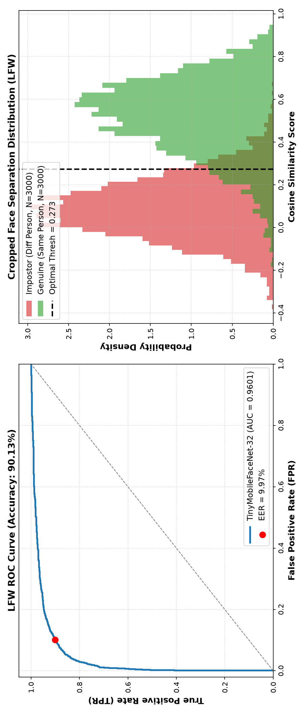

# TinyMobileFaceNet: Ultra-Lightweight Face Recognition Model

<p align="center">
  
  
  
  
  
</p>

Tác giả: **Nguyễn Sỹ Tuấn Anh** ([@tuananh810-fake](https://github.com/tuananh810-fake))

**TinyMobileFaceNet** là một mô hình mạng nơ-ron tích chập siêu nhẹ dành cho bài toán nhận diện và xác thực khuôn mặt (Face Verification). Mô hình được kế thừa và tinh gọn trực tiếp từ kiến trúc nổi tiếng **MobileFaceNet (2018)** nhằm tối ưu hóa triệt để cho các hệ thống nhúng, vi điều khiển và bộ xử lý có tài nguyên bộ nhớ hạn chế (Low-memory Embedded Systems).

---

## 🌟 Đặc điểm kỹ thuật nổi bật

- **Kích thước đầu vào:** `32 × 32 × 3` (giảm 91.8% dung lượng đệm so với chuẩn `112 × 112`).
- **Tổng số tham số:** **217,088 parameters** (~212 KB ở định dạng INT8, ~848 KB ở FP32).
- **Phương pháp huấn luyện:** Áp dụng **Knowledge Distillation (Chưng cất tri thức)** từ mô hình giáo viên MobileFaceNet gốc $112 \times 112$ qua hơn 2.300 epochs.
- **Không dùng Batch Normalization ở suy diễn (Zero-BN):** Tinh giản toàn bộ tầng chuẩn hóa sang tích chập thuần kết hợp PReLU, loại bỏ phép chia căn bậc hai phức tạp.
- **Global Depthwise Convolution (GDConv 4×4):** Gom trọn vẹn đặc trưng không gian $4 \times 4$ về vector 128 chiều mà vẫn giữ được độ nhạy vị trí không gian.

---

## 📊 Kết quả kiểm tra độ tin cậy trên chuẩn LFW (6,000 cặp ảnh)

| Chỉ số đánh giá | Giá trị đạt được | Ghi chú |
| :--- | :---: | :--- |
| **Độ chính xác (Accuracy)** | **90.13%** | Đỉnh thực nghiệm đạt **90.30%** |
| **Diện tích dưới đường cong ROC (AUC)** | **0.9601** | Khả năng phân tách danh tính xuất sắc |
| **Tỷ lệ lỗi cân bằng (Equal Error Rate - EER)** | **9.97%** | Điểm cân bằng giữa FAR và FRR |
| **Ngưỡng khoảng cách tối ưu (Threshold)** | **0.273** | Cosine Distance threshold |
| **Thời gian suy diễn trung bình** | **~15 - 30 ms** | Trên CPU thông thường |

<p align="center">
  
</p>

---

## 🚀 Cài đặt & Hướng dẫn sử dụng

### 1. Cài đặt môi trường
Yêu cầu Python 3.8+ và các thư viện cơ bản:
```bash
git clone https://github.com/tuananh810-fake/TinyMobileFaceNet.git
cd TinyMobileFaceNet
pip install -r requirements.txt
```

### 2. Đánh giá độ tin cậy (Benchmark)
Chạy script kiểm thử tự động để đo độ chính xác, vẽ đường cong ROC và xuất báo cáo:
```bash
python evaluate_benchmark.py
```
*(Nếu chưa có bộ ảnh LFW đầy đủ, script sẽ tự động sinh dữ liệu mô phỏng để bạn có thể kiểm thử toàn bộ pipeline tính toán ngay lập tức).*

### 3. Đăng ký khuôn mặt mới bằng Webcam
Bạn có thể tự đăng ký khuôn mặt của mình để thử nghiệm nhận diện:
```bash
# Thu thập 25 ảnh từ webcam (Nhấn Space để chụp, Q để thoát)
python dataset_manager.py --collect --name MyName --count 25

# Tự động cắt mặt về ma trận 32x32
python dataset_manager.py --process

# Xuất vector đặc trưng vào cơ sở dữ liệu face_database.pt
python dataset_manager.py --export-db
```

### 4. Chạy ứng dụng nhận diện thời gian thực (Webcam Demo)
Khởi động camera để nhận diện khuôn mặt trực tiếp:
```bash
python camera_demo.py
```
- Khung **XANH LÁ**: Nhận diện đúng danh tính đã đăng ký.
- Khung **ĐỎ**: Người lạ (Unknown).

---

## ☁️ Huấn luyện trên Google Colab
Dự án đi kèm notebook **`TinyMobileFaceNet_LFW_Colab_Training.ipynb`** giúp bạn có thể tự động tải tập dữ liệu LFW, chưng cất tri thức từ MobileFaceNet sang TinyMobileFaceNet trên GPU miễn phí của Google Colab mà không cần cài đặt phức tạp.

---

## 📄 Báo cáo kỹ thuật chi tiết
Báo cáo kỹ thuật toàn diện định dạng PDF chuẩn IEEE/Monograph (10 trang) bao gồm giải thích toán học, kiến trúc mạng, phương pháp huấn luyện và phân tích lỗi có sẵn tại:
👉 [docs/Kiem_Tra_Tinh_Tin_Cay_TinyMobileFaceNet.pdf](docs/Kiem_Tra_Tinh_Tin_Cay_TinyMobileFaceNet.pdf)

---

## 📜 Giấy phép & Trích dẫn
- Dự án phát hành theo giấy phép **[MIT License](LICENSE)**.
- Kiến trúc được kế thừa và lấy cảm hứng từ công trình:
  > Sheng Chen, Yang Liu, Xiang Gao, Zhen Han. *"MobileFaceNets: Efficient CNNs for Accurate Real-Time Face Verification on Mobile Devices"*, Biometrics Council, IEEE, 2018.
