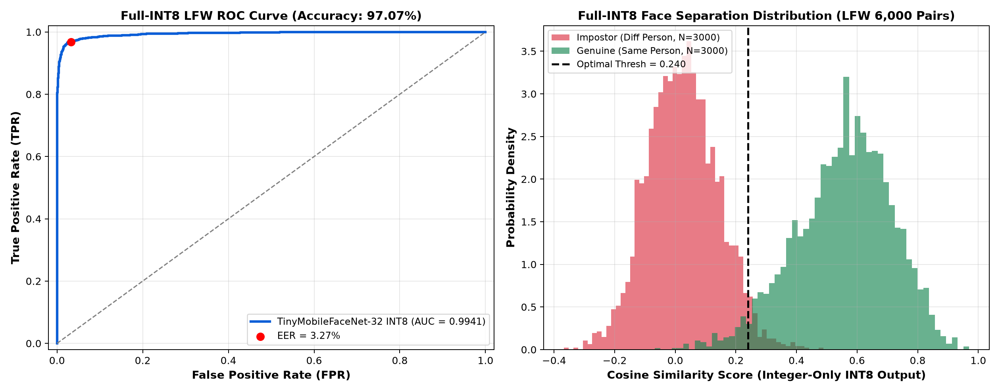

# TinyMobileFaceNet: Ultra-Lightweight Face Recognition Model

<p align="center">
  
  
  
  
  
  
</p>

Tác giả: **Nguyễn Sỹ Tuấn Anh** ([@tuananh810-fake](https://github.com/tuananh810-fake))

**TinyMobileFaceNet** là một mô hình mạng nơ-ron tích chập siêu nhẹ dành cho bài toán nhận diện và xác thực khuôn mặt (Face Verification). Mô hình được kế thừa và tinh gọn trực tiếp từ kiến trúc nổi tiếng **MobileFaceNet (2018)** nhằm tối ưu hóa triệt để cho các hệ thống nhúng, vi điều khiển và bộ tăng tốc phần cứng FPGA (Zero External DRAM, 100% Integer-Only INT8).

---

## 🌟 Đặc điểm kỹ thuật nổi bật

- **Kích thước đầu vào:** `32 × 32 × 3` (giảm 91.8% dung lượng đệm so với chuẩn `112 × 112`).
- **Tổng số phép tính (MACs):** **5,758,976 MACs (`5.759 MMACs`)** (~6.40 ms / ~156 FPS trên mảng 9 DSP @ 100 MHz).
- **Dung lượng phần cứng Full-INT8 (Zero-BN):**
  - Trọng số `Conv2d` (`INT8`): **215,360 bytes (`210.31 KB`)**
  - Hệ số `PReLU` (`Q0.7 INT8`): **1,728 bytes (`1.69 KB`)**
  - Hằng số `Bias` (`INT32`): **2,528 giá trị (`9.88 KB`)**
  - Hệ số làm tròn `M` (`INT32`, dịch cố định `>> 16`): **2,528 giá trị (`9.88 KB`)**
  - Bộ đệm `Ping-Pong RAM` tối thiểu: **24.00 KB** (khuyến nghị **2 bank × 16 KB = 32 KB**).
- **Phương pháp huấn luyện:** **BatchNorm + BN Folding** $\to$ **Relational Knowledge Distillation (Cosine + Pairwise RKD)** với căn chỉnh 5 điểm **RetinaFace** $\to$ **Quantization-Aware Training (QAT Full-INT8)**.

---

## 📊 Kết quả kiểm tra độ tin cậy trên chuẩn LFW (10-Fold, 6,000 cặp ảnh)

| Phiên bản mô hình | 10-Fold Accuracy | ROC AUC | Equal Error Rate (EER) | Threshold |
| :--- | :---: | :---: | :---: | :---: |
| Bản v1 (No-BN + Haar Cascade) | 90.45% | 0.9603 | 10.12% | 0.272 |
| Bản v2 FP32 Folded-BN (RetinaFace + RKD) | 96.68% ± 0.83% | 0.9945 | 3.22% | 0.243 |
| **🏆 Bản v3 QAT Full-INT8 (Integer-Only Golden Model)** | **97.07% ± 0.78%** | **0.9941** | **3.27%** | **0.240** |

<p align="center">
  
</p>

## ⚙️ Bộ tham số phần cứng Full-INT8 (`hardware_export/`)
- **Bảng tiêu chí gốc 18 tầng (MACs, RAM, Latency):** [hardware_export/Hardware_Baseline_Spec.md](hardware_export/Hardware_Baseline_Spec.md)
- **Thông số lượng tử hóa (`M`, `shift=16`, offset, shape):** [hardware_export/quant_params.json](hardware_export/quant_params.json)
- **File nạp ROM/RAM Verilog (`$readmemh`):** `weights_int8.mem`, `bias_int32.mem`, `prelu_q07.mem`, `requant_mult_int32.mem`
- **Đáp án chuẩn từng tầng cho Testbench Verilog:** `hardware_export/golden_vectors/` (`input_32x32_int8.mem` + 18 tầng + 2 Residual + `final_embedding_128d_int8.txt`)

---

## 🚀 Cài đặt & Hướng dẫn sử dụng

### 1. Cài đặt môi trường
Yêu cầu Python 3.8+ và các thư viện cơ bản:
```bash
git clone https://github.com/tuananh810-fake/TinyMobileFaceNet.git
cd TinyMobileFaceNet
pip install -r requirements.txt
```

### 2. Đánh giá độ tin cậy (Benchmark)
Chạy script kiểm thử tự động để đo độ chính xác, vẽ đường cong ROC và xuất báo cáo:
```bash
python evaluate_benchmark.py
```
*(Nếu chưa có bộ ảnh LFW đầy đủ, script sẽ tự động sinh dữ liệu mô phỏng để bạn có thể kiểm thử toàn bộ pipeline tính toán ngay lập tức).*

### 3. Đăng ký khuôn mặt mới bằng Webcam
Bạn có thể tự đăng ký khuôn mặt của mình để thử nghiệm nhận diện:
```bash
# Thu thập 25 ảnh từ webcam (Nhấn Space để chụp, Q để thoát)
python dataset_manager.py --collect --name MyName --count 25

# Tự động cắt mặt về ma trận 32x32
python dataset_manager.py --process

# Xuất vector đặc trưng vào cơ sở dữ liệu face_database.pt
python dataset_manager.py --export-db
```

### 4. Chạy ứng dụng nhận diện thời gian thực (Webcam Demo)
Khởi động camera để nhận diện khuôn mặt trực tiếp:
```bash
python camera_demo.py
```
- Khung **XANH LÁ**: Nhận diện đúng danh tính đã đăng ký.
- Khung **ĐỎ**: Người lạ (Unknown).

---

## ☁️ Huấn luyện trên Google Colab
Dự án đi kèm notebook **`TinyMobileFaceNet_LFW_Colab_Training.ipynb`** giúp bạn có thể tự động tải tập dữ liệu LFW, chưng cất tri thức từ MobileFaceNet sang TinyMobileFaceNet trên GPU miễn phí của Google Colab mà không cần cài đặt phức tạp.

---

## 📄 Báo cáo kỹ thuật chi tiết
Báo cáo kỹ thuật toàn diện định dạng PDF chuẩn IEEE/Monograph (10 trang) bao gồm giải thích toán học, kiến trúc mạng, phương pháp huấn luyện và phân tích lỗi có sẵn tại:
👉 [docs/Kiem_Tra_Tinh_Tin_Cay_TinyMobileFaceNet.pdf](docs/Kiem_Tra_Tinh_Tin_Cay_TinyMobileFaceNet.pdf)

---

## 📜 Giấy phép & Trích dẫn
- Dự án phát hành theo giấy phép **[MIT License](LICENSE)**.
- Kiến trúc được kế thừa và lấy cảm hứng từ công trình:
  > Sheng Chen, Yang Liu, Xiang Gao, Zhen Han. *"MobileFaceNets: Efficient CNNs for Accurate Real-Time Face Verification on Mobile Devices"*, Biometrics Council, IEEE, 2018.
